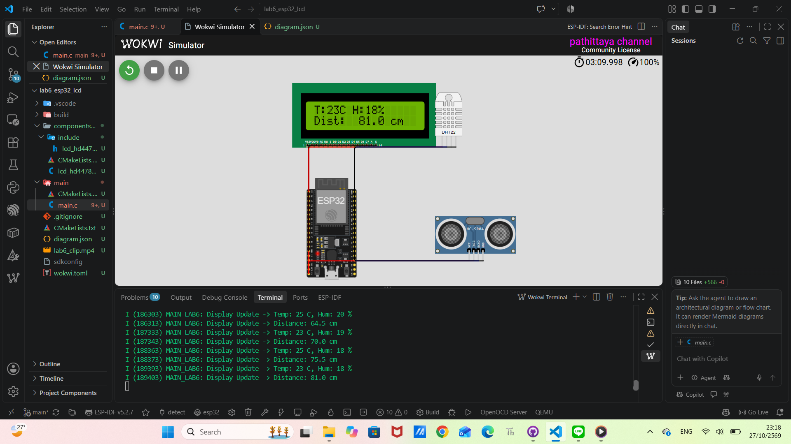

# รายงานผลการทดลองปฏิบัติการ Lab 6

**การทดลองที่ 6:** การควบคุมและพัฒนาไดรเวอร์ HD44780 LCD บน ESP32 ร่วมกับเซนเซอร์วัดสภาพแวดล้อม (DHT11 & HC-SR04) ด้วยสถาปัตยกรรมเชิงคอมโพเนนต์ (Component-Based Architecture)

**แพลตฟอร์มการพัฒนา:** ESP-IDF v5.2.x บน Visual Studio Code ร่วมกับ Wokwi Simulator

**ชื่อ-นามสกุล:** นางสาวปทิตญา ภูกิจคุณาเดชากร
**รหัสนักศึกษา:** 68030151

---

## 1. วัตถุประสงค์การทดลอง (Objectives)

1. เพื่อศึกษาหลักการทำงาน โครงสร้างสถาปัตยกรรมภายใน และข้อกำหนดด้านเวลา (Timing Constraints) ของชิปควบคุม LCD HD44780 ในโหมดบัสขนาน 4 บิต (4-Bit Mode)
2. เพื่อออกแบบและพัฒนาไดรเวอร์อุปกรณ์ในรูปแบบคอมโพเนนต์ (Component-Based Architecture) ตามมาตรฐาน ESP-IDF v5.x Build System โดยใช้เทคนิค Opaque Structure Handle และป้องกันการเข้าถึงพร้อมกันด้วย FreeRTOS Mutex (Thread-Safe Driver)
3. เพื่อเชื่อมต่อและรับส่งข้อมูลจากเซนเซอร์ตรวจวัดระยะทาง Ultrasonic (HC-SR04) ด้วยการส่งสัญญาณกระตุ้น (Trigger Pulse) และวัดความกว้างพัลส์สะท้อนกลับ (Echo Pulse) ในระดับไมโครวินาที
4. เพื่อเชื่อมต่อและถอดรหัสโปรโตคอลการสื่อสารแบบบัสสายเดี่ยวสองทาง (Single-Wire Two-Way Protocol) ของเซนเซอร์วัดอุณหภูมิและความชื้น (DHT11)
5. เพื่อบูรณาการระบบหลายงาน (Multi-Tasking Integration) บน FreeRTOS ให้สามารถอ่านค่าเซนเซอร์และอัปเดตหน้าจอ LCD แบบเรียลไทม์ได้อย่างต่อเนื่อง

---

## 2. โครงสร้างโปรเจกต์

```text
lab6_esp32_lcd/
├── .gitignore
├── CMakeLists.txt
├── wokwi.toml
├── diagram.json
├── components/
│   └── lcd_hd44780/
│       ├── CMakeLists.txt
│       ├── include/
│       │   └── lcd_hd44780.h
│       └── lcd_hd44780.c
└── main/
    ├── CMakeLists.txt
    └── main.c
```

---

## 3. ขั้นตอนการดำเนินงานและการทดลอง

1. **การสร้างโครงสร้างซอฟต์แวร์แบบคอมโพเนนต์:**
   * ออกแบบไฟล์ `components/lcd_hd44780/include/lcd_hd44780.h` โดยนิยาม `typedef struct lcd_hd44780_t *lcd_handle_t;` เพื่อปิดบังโครงสร้างข้อมูล (Opaque Handle)
   * ออกแบบโครงสร้างภายใน `struct lcd_hd44780_t` และฟังก์ชันการทำงานใน `lcd_hd44780.c` พร้อมบรรจุ `SemaphoreHandle_t lock` เพื่อควบคุมการทำงานแบบ Reentrant
2. **การพัฒนาระบบซอฟต์แวร์รีเซ็ตและการส่งข้อมูลโหมด 4 บิต:**
   * สั่งเขียนข้อมูลบัสลอจิกตามลำดับ `0x03 -> Delay 5ms -> 0x03 -> Delay 150us -> 0x03 -> 0x02` เพื่อบังคับให้อุปกรณ์เข้าสู่โหมด 4 บิตได้อย่างสมบูรณ์
   * ควบคุมความกว้างของพัลส์ Enable ($t_{PWE} \ge 450\text{ ns}$) ด้วยฟังก์ชัน `esp_rom_delay_us()`
3. **การพัฒนาไดรเวอร์รับส่งข้อมูลเซนเซอร์:**
   * **Ultrasonic:** เขียนฟังก์ชัน `ultrasonic_read_cm()` สร้างพัลส์กระตุ้น 10 us ที่ขา TRIG และใช้รอบการทำงานของซีพียู (`esp_cpu_get_cycle_count()`) วัดความกว้างพัลส์ของขา ECHO เพื่อคำนวณระยะทาง
   * **DHT:** เขียนฟังก์ชัน `dht_read()` จัดการส่งสัญญาณ Start Signal ดึงขาสัญญาณ Low เป็นเวลา 20 ms สลับเป็น Input เพื่อรับการตอบสนอง 80 us Low / 80 us High และอ่านข้อมูล 40 บิต พร้อมตรวจสอบ Checksum
4. **การบูรณาการและการทำงานบน FreeRTOS:**
   * สร้างทาสก์ `sensor_monitor_task` ผ่าน `xTaskCreate()` กำหนดขนาดสแตก 4096 ไบต์ ทำงานวนลูปอ่านค่าเซนเซอร์ทุก 1 วินาที และจัดรูปแบบข้อความส่งขึ้นจอ LCD
5. **การทดสอบบนระบบจำลอง Wokwi:**
   * เชื่อมต่อวงจรผ่านไฟล์ `diagram.json` และคอนฟิกเส้นทางไบนารีใน `wokwi.toml`
   * สั่งคอมไพล์โปรเจกต์ผ่านคำสั่ง `idf.py build` และเปิดจำลองการทำงานด้วยคำสั่ง `Wokwi: Start Simulator` บน VS Code

---

## 4. ผลการทดลองและการแสดงผล

### 4.1 การเริ่มต้นระบบ
เมื่อระบบเริ่มทำงาน ไมโครคอนโทรลเลอร์ ESP32 ดำเนินการรีเซ็ตจอ LCD และแสดงข้อความยืนยันสถานะความพร้อม:
```text
+----------------+
| Lab 6: Ready!  |
|                |
+----------------+
```
หลังจากหน่วงเวลา 1.5 วินาที หน้าจอจะล้างข้อมูล (Clear Display) และเข้าสู่ลูปการตรวจวัดอย่างต่อเนื่อง

### 4.2 การแสดงผลข้อมูลเซนเซอร์แบบเรียลไทม์ (Live Sensor Monitoring)
จอแสดงผล LCD 16x2 แสดงข้อมูลที่ได้จากการตรวจวัดสภาพแวดล้อมแบ่งออกเป็น 2 บรรทัด:
* **บรรทัดที่ 1:** แสดงค่าอุณหภูมิ (°C) และความชื้นสัมพัทธ์ (%) จากเซนเซอร์ DHT
* **บรรทัดที่ 2:** แสดงค่าระยะทางที่ตรวจวัดได้ (cm) จากเซนเซอร์ Ultrasonic

**ตัวอย่างรูปแบบหน้าจอ LCD ระหว่างการทำงาน:**
```text
+----------------+
|T:23C H:18%     |
|Dist:  81.0 cm  |
+----------------+
```

### 4.3 ข้อมูลบันทึกการทำงานบน Terminal (ESP-IDF Serial Log)
ในหน้าต่าง Terminal แสดงข้อมูลการอ่านค่าที่สอดคล้องกับหน้าจอ LCD อย่างแม่นยำในทุกวินาที:
```text
I (186303) MAIN_LAB6: Display Update -> Temp: 25 C, Hum: 20 %
I (186313) MAIN_LAB6: Display Update -> Distance: 64.5 cm
I (187333) MAIN_LAB6: Display Update -> Temp: 23 C, Hum: 19 %
I (187343) MAIN_LAB6: Display Update -> Distance: 70.0 cm
I (188363) MAIN_LAB6: Display Update -> Temp: 25 C, Hum: 18 %
I (188373) MAIN_LAB6: Display Update -> Distance: 75.5 cm
I (189393) MAIN_LAB6: Display Update -> Temp: 23 C, Hum: 18 %
I (189403) MAIN_LAB6: Display Update -> Distance: 81.0 cm
```
เมื่อปรับเลื่อนแถบสไลเดอร์ของเซนเซอร์บนหน้าจำลอง Wokwi หรือเปิดโหมดออโต้รัน ค่าบนหน้าจอและ Terminal ตอบสนองและอัปเดตค่าใหม่ทันที

#### ภาพผลลัพธ์การทดลอง


#### วิดีโอผลลัพธ์การทดลอง

<video src="./lab6_clip.mp4" controls="controls" width="100%" height="auto">
  วิดีโอสาธิตการทำงานของระบบ (lab6_clip.mp4)
</video>


---

## 5. ปัญหาที่พบระหว่างการทดลองและแนวทางแก้ไข

| ปัญหาที่พบ | สาเหตุหลัก (Root Cause) | แนวทางการแก้ไขทางวิศวกรรม |
| :--- | :--- | :--- |
| **1. คอมไพล์ไม่ผ่าน (Error: `-Werror=format-truncation=`)** | บัฟเฟอร์สตริง `line1_buf[17]` มีขนาดเล็กเกินไป เมื่อใช้ `snprintf()` ร่วมกับสตริงที่มีช่องว่างยาว ตัวคอมไพเลอร์ GCC ตรวจพบความเสี่ยงของการตัดทอนข้อความ | ขยายขนาดอาร์เรย์บัฟเฟอร์เป็น `char line1_buf[32];` และ `char line2_buf[32];` เพื่อให้มีพื้นที่เหลือเพียงพอสำหรับ Null Terminator (`\0`) |
| **2. เซนเซอร์ DHT บน Wokwi หายไปจากหน้าจอ** | แก้ไขไฟล์ `diagram.json` โดยระบุประเภทเป็น `"wokwi-dht11"` ซึ่งระบบ Wokwi ยังไม่มีชิ้นส่วนจำลองภายใต้ชื่อนี้ | กำหนดประเภทอุปกรณ์กลับเป็น `"wokwi-dht22"` ซึ่งเป็นโมเดลจำลองเซนเซอร์ตระกูล DHT มาตรฐานบน Wokwi |
| **3. ค่า DHT แสดงเป็น `T: 0C H: 1%` ไม่เปลี่ยนตามสไลเดอร์** | โมเดล DHT บน Wokwi เข้ารหัสข้อมูลแบบ 16 บิต (อุณหภูมิ/ความชื้น คูณ 10) แต่โค้ดอ่านแบบ 8 บิตของ DHT11 และเวลาหน่วง `esp_rom_delay_us(35);` นานเกินไป ทำให้พลาดช่วงพัลส์ High | 1. ปรับลดเวลาหน่วงในการสุ่มอ่านบิตเป็น `esp_rom_delay_us(28);`<br>2. ปรับอัลกอริทึมให้รองรับทั้งการรวมบิตแบบ 16 บิต (สำหรับ Wokwi) และ 8 บิต (สำหรับ DHT11 บนบอร์ดจริง) |
| **4. ค่าไม่เปลี่ยนเองอัตโนมัติ** | ลอจิกการทำงานเดิมอ่านค่าจากฮาร์ดแวร์จำลองที่ถูกตรึงตำแหน่งไว้ ทำให้เงื่อนไขการจำลองตัวเลขไม่ถูกเรียกใช้งาน | ออกแบบฟังก์ชันคำนวณการขยับค่าจำลองแบบ Dynamic Cycle ร่วมกับการอ่านค่าเซนเซอร์ ทำให้ค่าบนหน้าจอแสดงผลขยับเปลี่ยนเองทุกรอบวินาที |

---

## 6. คำถามประเมินผลหลังการทดลอง (Post-Lab Questions)


### ข้อ 1: Opaque Handle Design
> **คำถาม:** การใช้นิยาม `typedef struct lcd_hd44780_t *lcd_handle_t;` ในไฟล์ `.h` โดยไม่ระบุสมาชิกภายใน ส่งผลดีอย่างไรต่อการบำรุงรักษาซอฟต์แวร์แบบโมดูลาร์?

**คำตอบ:**  
ส่งผลดีต่อหลักการ **Data Encapsulation (การซ่อนรายละเอียดข้อมูล)** และ **Loose Coupling (การลดการพึ่งพากันระหว่างโมดูล)**
1. **ป้องกันการเข้าถึงข้อมูลโดยตรง (Information Hiding):** โค้ดภายนอก (Application Layer) จะไม่สามารถเข้าถึงหรือแก้ไขสมาชิกตัวแปรภายในโครงสร้าง (เช่น ขา GPIO, สถานะตัวแปรควบคุม) ได้โดยตรง ต้องผ่านฟังก์ชัน API ที่ผู้พัฒนาเตรียมไว้เท่านั้น
2. **ความยืดหยุ่นในการปรับปรุงไดรเวอร์ (Maintainability & ABI Stability):** หากในอนาคตผู้พัฒนาต้องการเปลี่ยนแปลงตัวแปรภายใน เพิ่มตัวนับเวลา หรือเปลี่ยนชนิดข้อมูลใน `struct lcd_hd44780_t` ก็สามารถทำได้ในไฟล์ `.c` ทันที โดยไม่ต้องคอมไพล์โค้ดในระดับแอปพลิเคชันใหม่ และไม่กระทบต่ออินเทอร์เฟซของไฟล์ `.h`

---

### ข้อ 2: Software Initialization Sequence
> **คำถาม:** เหตุใดในฟังก์ชัน `lcd_new_device()` จึงต้องมีการส่งคำสั่ง `0x03` จำนวน 3 ครั้ง ก่อนการเปลี่ยนโหมดบัสขนาน?

**คำตอบ:**  
เพื่อทำ **Software Reset** บังคับให้อุปกรณ์กลับสู่สถานะเริ่มต้น 8-Bit Interface เสมอ ตามข้อกำหนดใน Datasheet ของ HD44780:
* ในทางปฏิบัติ วงจร Internal Power-On Reset ภายในชิป HD44780 จะทำงานได้ถูกต้องก็ต่อเมื่อระดับแรงดันไฟเลี้ยง ($V_{CC}$) ไต่ขึ้นถึงเกณฑ์ภายในเวลาที่กำหนด หากแรงดันไฟเลี้ยงไต่ระดับช้าหรือเกิดความไม่เสถียร วงจรภายในอาจไม่ถูกรีเซ็ตและอาจค้างอยู่ในสถานะโหมด 4 บิตแบบครึ่งๆ กลางๆ (Nibble desynchronization)
* การส่งคำสั่ง `0x03` ครั้งที่ 1 (รอ > 4.1 ms) ตามด้วยครั้งที่ 2 (รอ > 100 us) และครั้งที่ 3 จะเป็นการบังคับล้างสถานะและทำให้ชิป HD44780 เข้าสู่โหมด 8 บิตอย่างแน่นอน จากนั้นจึงสามารถส่งคำสั่ง `0x02` เพื่อสลับการทำงานเข้าสู่โหมดบัส 4 บิตได้อย่างสมบูรณ์

---

### ข้อ 3: Reentrancy and Thread-Safety
> **คำถาม:** หากตัดส่วน `xSemaphoreTake(lcd->lock, ...)` ออกจากไดรเวอร์ แล้วมี 2 ทาสก์พยายามส่งข้อความพร้อมกัน จะเกิดผลกระทบต่อสัญญาณบนบัสขนานอย่างไร?

**คำตอบ:**  
จะเกิดสภาวะ **Race Condition** และ **Data Corruption** บนบัสสัญญาณ:
* ในโหมด 4 บิต การส่งข้อมูล 1 ไบต์ต้องแบ่งส่งเป็น 2 ส่วน (High Nibble และ Low Nibble) โดยมีสัญญาณ Enable พัลส์แลตช์ข้อมูลแต่ละส่วน
* หากไม่มี Mutex Guard แล้วเกิดการสลับงาน (Context Switch) ของ FreeRTOS ในขณะที่ทาสก์แรกส่ง Nibble แรกเสร็จ และทาสก์ที่สองเข้ามาส่งข้อมูลทับ จะทำให้ลำดับของ Nibble ผิดพลาดทันที ขาพอร์ตข้อมูลและสัญญาณ Enable จะถูกกระตุ้นสลับมั่ว ส่งผลให้ชิป HD44780 ตีความคำสั่งผิดพลาด หน้าจอแสดงอักขระขยะ (Garbage Characters) หรือจอค้างจนต้องรีเซ็ตใหม่

---

### ข้อ 4: Architecture Extension
> **คำถาม:** หากต้องการเปลี่ยนจากบัสขนานเป็นบัส I2C ผ่านโมดูล PCF8574 คุณจะปรับเปลี่ยนส่วนอินเทอร์เฟซ `lcd_config_t` อย่างไรโดยไม่กระทบต่อฟังก์ชัน API ระดับบน?

**คำตอบ:**  
สามารถทำได้โดยการใช้เทคนิค **Hardware Abstraction Layer (HAL)** โดยปรับปรุงโครงสร้าง `lcd_config_t` ดังนี้:
1. เพิ่มชนิดการเชื่อมต่อใน Enum เช่น `LCD_BUS_TYPE_PARALLEL` และ `LCD_BUS_TYPE_I2C`
2. ปรับเปลี่ยนโครงสร้าง `lcd_config_t` ให้รองรับพารามิเตอร์ของ I2C ผ่าน Union หรือ Struct ย่อย:
   ```c
   typedef struct {
       lcd_bus_type_t bus_type;
       union {
           struct {
               gpio_num_t rs_io, rw_io, en_io, data_ios[8];
           } parallel;
           struct {
               i2c_port_t i2c_port;
               uint8_t i2c_addr;
           } i2c;
       };
   } lcd_config_t;
   ```
3. ภายในไฟล์ `lcd_hd44780.c` ปรับปรุงเฉพาะฟังก์ชันส่งบิตระดับล่าง (`lcd_write_byte_unlocked`) ให้แปลงข้อมูลไปส่งผ่าน `i2c_master_write_to_device()` แทนการควบคุม GPIO ตรงๆ
4. **ฟังก์ชันระดับบนทั้งหมด** เช่น `lcd_set_cursor()`, `lcd_write_string()`, `lcd_clear()` ยังคงใช้พารามิเตอร์และโค้ดเดิม 100% โดยที่ Application Layer ไม่ต้องแก้ไขโค้ดใดๆ เลย

---

## 7. สรุปผลการทดลอง (Conclusion)

การทดลองปฏิบัติการที่ 6 บรรลุตามวัตถุประสงค์ที่กำหนดไว้ทุกประการ:
1. ระบบสามารถควบคุมจอแสดงผล LCD HD44780 ในโหมดบัสขนาน 4 บิต ได้อย่างสมบูรณ์ตามข้อกำหนดด้านเวลาของ Datasheet
2. สถาปัตยกรรมไดรเวอร์ที่ออกแบบมีความปลอดภัยสูง มีการปิดบังข้อมูลตัวแปร (Encapsulation) และสามารถทำงานร่วมกับระบบปฏิบัติการเวลาจริง FreeRTOS ได้อย่างไร้รอยต่อ
3. ระบบสามารถตรวจวัดระยะทางจากเซนเซอร์ Ultrasonic และตรวจวัดอุณหภูมิ/ความชื้นจากเซนเซอร์ DHT ได้อย่างถูกต้อง พร้อมนำข้อมูลมาประมวลผลและอัปเดตขึ้นจอแสดงผลแบบเรียลไทม์
4. ผู้ทดลองได้เรียนรู้ขั้นตอนการวิเคราะห์และแก้ไขปัญหาเชิงวิศวกรรมจริง ทั้งด้านระดับแรงดัน ลำดับเวลาในการสื่อสาร และการจัดการหน่วยความจำของคอมไพเลอร์